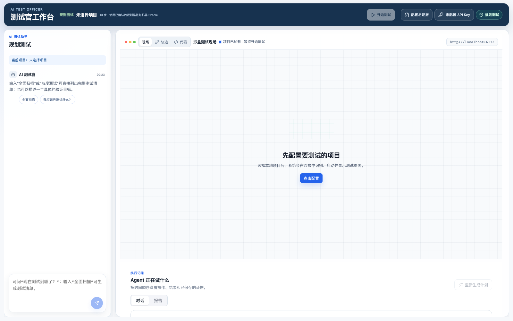
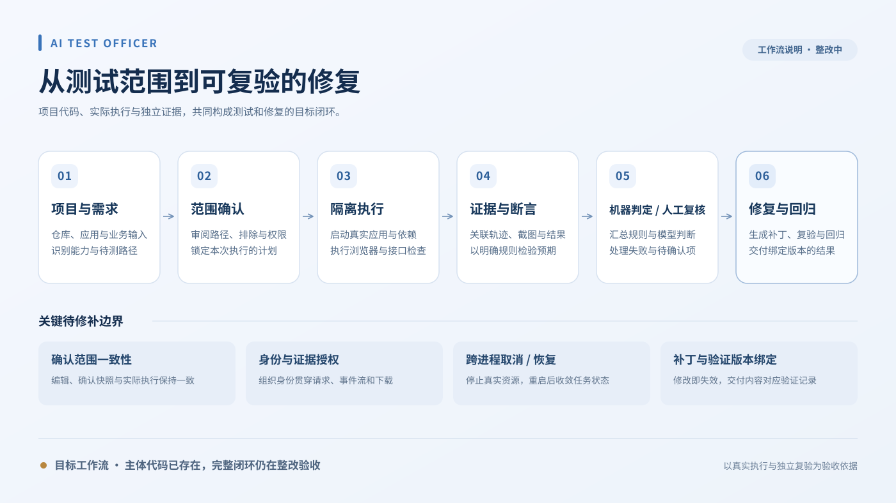
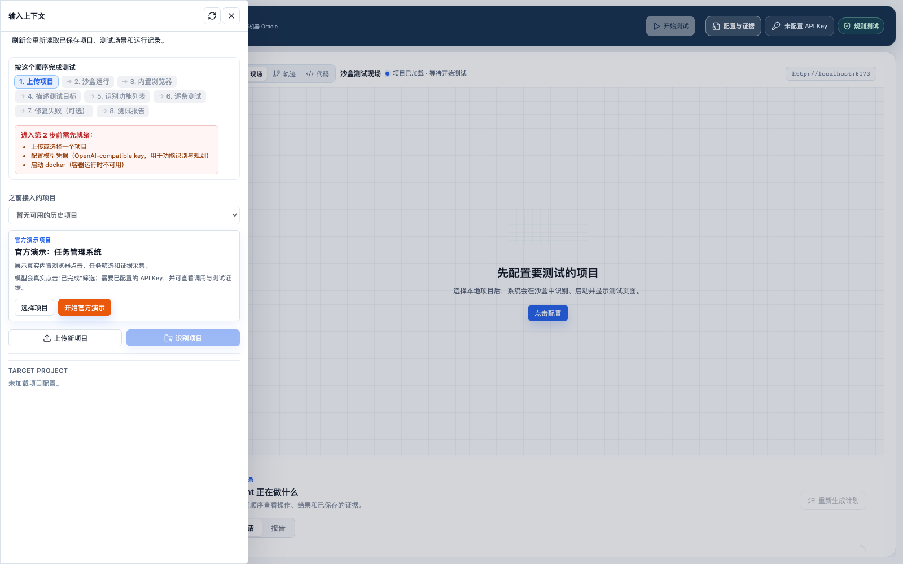
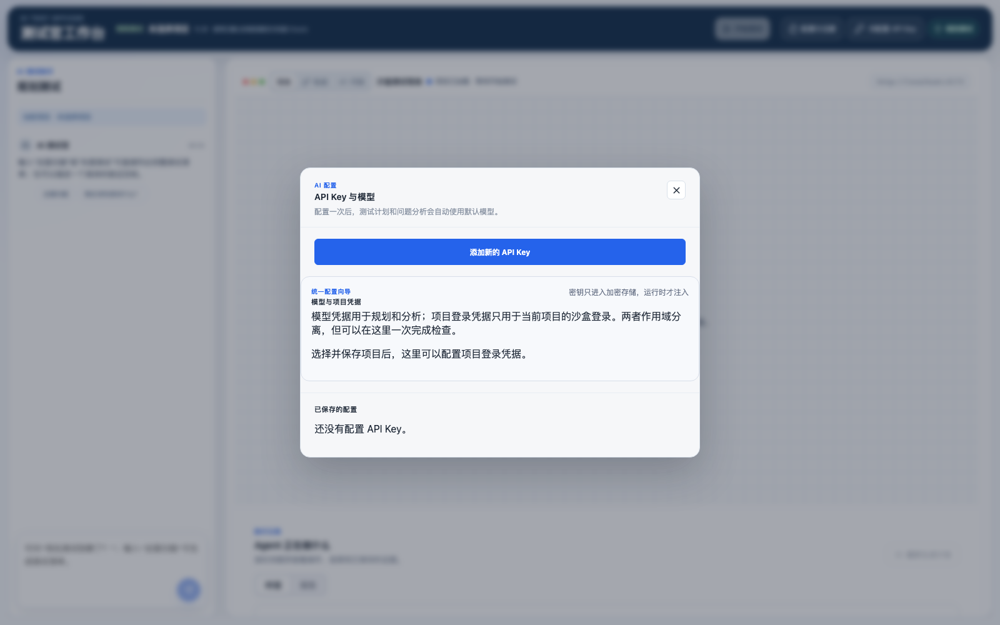

# AI Test Officer

面向开发、测试与验收人员的 AI 测试工作台。接入项目与需求，确认测试范围，驱动浏览器和结构化执行器运行检查，收集证据，并在发现问题后进入沙盒修复与回归。

**当前阶段：核心模块已有实现，正在修复功能衔接与验收可信度问题，尚未完成生产闭环验收。**

[代码审计](docs/code-audit-2026-09-06.md) · [详细修复方案](docs/remediation-plan.md) · [快速开始](#快速开始) · [真实验收标准](#真实验收标准)



*2026-09-06，从真实 React/Vite 工作台与 Express API 截取。图中尚未选择项目、配置模型或执行测试；界面里的默认规则步数不是本次模型规划结果。截图仅展示界面，不作为功能验收通过证明。图片来源与范围见[截图说明](docs/assets/README.md)。*

## 项目是做什么的

用户可以提供本地代码目录、应用地址、需求、Git diff 或缺陷上下文。系统的目标是把这些输入组织成可以执行、可以审核、可以追溯的测试任务：

1. **接入项目**：识别技术栈、启动入口、依赖、页面和接口。
2. **确认范围**：形成业务功能与测试路径，展示前置条件、断言和权限，交由用户审核。
3. **执行检查**：通过 Playwright，以及受约束的 API、数据、任务和命令执行器完成检查。
4. **保存证据**：关联截图、DOM、网络、日志、Trace、断言、Run 和 Attempt。
5. **判断结果**：由机器规则形成结论，按需使用模型解释复杂证据，并支持人工复核。
6. **修复与回归**：在源码副本中编辑补丁，重新验证，最后导出或按权限应用修改。

例如，需求是“任务筛选只能显示已完成任务”：完整验收需要真的启动应用、点击筛选、核查页面和接口数据、保存证据；如果发现缺陷，还要证明补丁使同一项检查从失败变为通过。



*这是目标工作流说明图。主体模块存在不等于以上步骤已经在生产环境全部贯通。*

## 当前验证结果

以下结果来自 **2026-09-06、基于 `d883ca7` 且包含未提交改动的本地工作区**。它们是该次审计结果，不是当前 GitHub 提交或后续版本的发布认证；本次文档更新也没有实施修复方案。

| 检查 | 实际结果 | 能证明什么 |
| --- | --- | --- |
| `npm run build` | 通过；有前端产物大小警告 | 当时工作区可编译、打包 |
| `npm run lint` | 通过 | 当时源码满足已配置 lint 规则 |
| `npm run quality:contracts` | 通过，扫描 370 个源码文件 | 满足该脚本检查的契约约束 |
| `npm run size-guard` | 失败：`agent/src/server.ts` 为 2064 行，超过 2000 行门禁 | 质量门禁仍有阻塞 |
| `npm test` | 退出码为 0，但 Agent 测试提前退出 | **不能记为整套测试通过** |
| Agent 执行进度核验 | 第 6 个入口未结束，后续 102 个入口未到达 | 确认测试入口存在完整性问题 |
| Agent 补充检查 | 临时副本跳过该悬挂入口，其余 107 个入口及 selfTest 返回；4 个可选环境用例按现有开关跳过 | 定向诊断结果，不能替代原始套件完整运行 |
| Workbench Vitest | 5 个测试文件、53 个测试通过 | 前端已覆盖部分组件与状态行为 |
| 真实模型 + 外部项目全流程 | 本次未执行 | 尚无本轮完整通过结论 |
| Docker/PostgreSQL/Redis/MinIO/OIDC 完整部署 | 本次未执行 | 尚无本轮生产部署通过结论 |

原始审计日志保留在本地、未随 Git 提交。公开的[代码审计](docs/code-audit-2026-09-06.md)列出方法、源码位置、复现条件和验证边界。历史报告不能代替当前版本重新验收。

## 已有模块与当前缺口

| 环节 | 已有实现 | 必须补齐的关键问题 |
| --- | --- | --- |
| 项目接入 | 项目检测、运行配置、源码与依赖缓存 | 项目切换的异步响应串扰；生产存储与路径一致性 |
| 测试规划 | 需求对话、业务功能/路径编译、规划清单 | 用户删除或新增的路径与实际执行范围不一致 |
| 身份与权限 | OIDC、角色/项目授权、凭据存储 | 登录入口未接通；部分请求硬编码组织或遗漏 Bearer；直接文件下载缺项目授权 |
| 执行与恢复 | LangGraph、父子任务、BullMQ、租约、执行器 | 跨进程取消、父任务超时收尾与重启恢复仍需真实验证和修复 |
| 证据与判定 | Artifact、完整性校验、证明图、机器 Gate、LLM Judge | 下载权限与指标真实性；独立业务判定不能沿用 Agent 自评 |
| 修复与交付 | 沙盒副本、编辑、Diff、复测、导出与应用 | 再次编辑未使旧验证失效；验证没有完整绑定补丁版本 |
| 生产运行 | PostgreSQL、Redis、S3/MinIO 与容器配置 | 只读容器内仍有本地写入；控制服务与执行节点的职责、网络和共享状态未完全贯通 |

技术栈识别包含 Node.js、Python、Go、Rust、Java、Ruby、PHP 和静态站点的适配逻辑。**识别出框架或启动命令，不代表该类项目已经在沙盒中完成业务验收。** 外部服务、私有依赖与测试账号仍需实际配置。

## 修复与完善顺序

| 批次 | 交付内容 | 真实完成条件 |
| --- | --- | --- |
| A | 可信测试入口与验收口径 | 漏执行、挂起和缺少必需依赖均不能返回整套通过 |
| B | 版本化确认计划与前端状态隔离 | 用户确认范围、服务端快照和实际执行路径一致 |
| C | 登录、组织身份与证据权限 | 真实授权用户可完整使用，跨组织访问被拒绝 |
| D | 共享持久化与实际执行节点 | 从干净环境接入真实项目并启动，服务重启后状态一致 |
| E | 取消、超时与恢复 | 实际进程、浏览器和容器停止；父子任务能收敛到明确结果 |
| F | 与补丁版本绑定的修复验证 | 原缺陷失败 → 修复通过 → 撤销后再次失败，旧验证不能批准新修改 |
| G | 独立业务评估与发布门禁 | 真实模型、真实外部项目、独立断言与证据共同支撑结论 |
| H | 巡检、通知、知识库等外围能力 | 每个开放功能有实际验证记录，未配置状态准确 |

第一阶段聚焦一个锁定源码版本的真实外部项目，完成接入、规划、范围编辑、执行、证据查看、缺陷修复、回归和补丁下载，再扩展支持矩阵。逐模块改动、数据迁移、实施依赖与 12 项验收矩阵见[详细修复方案](docs/remediation-plan.md)。

## 快速开始

### 环境要求

- **Node.js 24**，与仓库 `.nvmrc` 一致。根 `engines` 声明的 `>=22.5` 低于当前部分前端依赖的要求，建议使用 24。
- npm，以及首次安装依赖所需的网络访问。
- Playwright Chromium，用于实际浏览器执行。
- Docker Desktop 或 Docker Engine，用于外部项目隔离运行、修复及容器化验收。仅启动开发 UI/API 不要求 Docker。
- 使用模型规划、浏览器决策或 AI 修复时，需要自行配置真实模型服务和有效凭据。

### 安装与启动

```bash
git clone https://github.com/ZZX0109/ai-test-officer.git
cd ai-test-officer
# 已安装 nvm 时可执行 nvm use；否则先安装 Node.js 24。
npm ci
npm run init:local-config
npx playwright install chromium
npm run build:packages
npm run dev
```

`init:local-config` 创建本地加密凭据配置与项目外的 master key；已有配置会保留。不要提交 `.env`、真实 API key、master key 或 `config/local-secrets.json`。

`npm run dev` 启动以下开发服务：

| 服务 | 默认地址 |
| --- | --- |
| Workbench | <http://127.0.0.1:6174> |
| Agent API | <http://127.0.0.1:4317> |
| 内置演示 Web | <http://127.0.0.1:6173> |
| 内置演示 API | <http://127.0.0.1:6172> |

内置演示应用使用仓库里的种子数据与演示服务，适合熟悉界面，**不作为真实外部项目能力的证明**。开发服务地址不等于生产部署方案。

```bash
npm run health:check
npm run stop:dev
# 需要后台运行开发服务时：
npm run dev:background
```

### 第一次使用

1. 打开工作台，进入“配置与证据”中的“项目与运行配置”。
2. 选择实际项目目录，识别并核查技术栈、启动命令和运行地址。
3. 配置必要的模型、目标系统账号和外部依赖，准备隔离运行环境。
4. 启动项目，确认工作台能访问实际页面。
5. 描述测试目标，审查测试范围、断言与权限，再确认执行。
6. 查看具体步骤、真实证据与结论；失败时再进入修复工作区。

目前范围编辑、生产身份、取消和修复验证仍有上表所列问题。试用记录不能直接用作发布依据。



### 模型配置

点击工作台顶部的模型配置按钮，填写服务地址、模型和 API key，保存并进行连接测试。项目包含 Chat Completions、Responses 与 Anthropic Messages 的传输适配，具体服务是否支持所需结构化输出和工具调用，需要实际验证。

连接测试只证明对应探测请求成功；声称 AI 规划、执行或修复成功时，还必须检查该阶段的真实调用记录、输出是否被执行，以及对应业务证据。缺少凭据或模型失败时，不应使用演示结果替代。



环境变量样例见 [.env.example](.env.example)，本地配置模板见 [config/config.example.json](config/config.example.json)。生产身份、共享密钥与存储改造见修复方案的 C、D 批次。

## 真实验收标准

正式验收需要锁定项目源码、依赖、执行镜像、测试数据、确认计划与模型配置版本，并保存本次运行的可核对证据。

- 使用真实项目构建、进程、浏览器、API 和数据服务；不得以固定成功响应、空实现、预录操作替代。
- 声称 AI 参与的阶段必须有真实模型调用及输出被消费的记录。
- 独立业务断言在运行前确定，不能复制 Agent 的自评结论，也不能被修复 Agent 删除或降低要求。
- 修复必须证明同一缺陷在修复前失败、修复后通过、撤销补丁后再次失败；追加无关注释不算修复。
- 补丁变化后旧验证失效；导出或应用的字节必须与已验证版本匹配。
- 缺少必需依赖、权限或证据时，记录失败或阻塞，不能跳过后仍判发布通过。
- 准确率、召回率与误报率需要独立标注数据；没有依据时标为不可计算，不能填零或用执行成功率代替。

现有部分 external evaluator 只核对结构或沿用系统结论，部分 repair evidence 脚本只证明编辑操作。这些结果不能用于证明业务判断正确或真实缺陷已修复，具体问题见[方案中的验收口径修正](docs/remediation-plan.md)。

## 开发与检查

```bash
npm run build
npm run lint
npm run quality:contracts
npm run size-guard
npm test
npm run typecheck
git diff --check
```

完整质量入口为 `npm run quality`。当前已知 size-guard 失败和 Agent 测试提前退出问题需要先修复；不能因为某条命令退出码为 0 就标记全部通过。

以下脚本依赖额外服务或凭据，需核查实际执行范围和生成证据：

| 命令 | 用途与边界 |
| --- | --- |
| `npm run test:workbench-e2e` | 工作台演示链路，要求服务和真实模型凭据；不是任意外部项目验收 |
| `npm run acceptance:production` | 隔离生产依赖栈检查，不能替代真实业务用例 |
| `npm run acceptance:external:preflight` | 外部项目预检查，构建/启动成功不等于业务正确 |
| `npm run contracts:generate` | 生成 OpenAPI 与客户端契约 |

## 代码结构与文档

| 目录 | 职责 |
| --- | --- |
| `agent/` | Express API、项目接入、规划、编排服务、证据、判定与修复 |
| `workbench-ui/` | React/Vite 工作台与状态管理 |
| `packages/contracts/` | Zod 契约与版本化数据结构 |
| `packages/agent-orchestration/` | LangGraph 编排 |
| `packages/execution-worker/` | 受控执行、资源预算与运行时边界 |
| `packages/playwright-runtime/` | 浏览器操作与采集 |
| `packages/desktop-runtime/`、`native/` | 原生桌面能力适配与 helper |
| `app-under-test/`、`fixtures/` | 内置演示与开发用例 |
| `data/`、`evaluation/` | 场景、项目配置与评估数据 |
| `deploy/`、`scripts/` | 部署、检查、验收与维护脚本 |

- [2026-09-06 代码审计](docs/code-audit-2026-09-06.md)
- [修复与完善实施方案](docs/remediation-plan.md)
- [LLM 传输与轨迹说明](docs/llm-trajectory-delivery.md)
- [可持续 Agent 模块设计](docs/sustainable-agent-modules.md)
- [安全威胁模型](docs/security-threat-model.md)
- [截图来源与验证范围](docs/assets/README.md)

架构和设计文档描述实现意图；功能是否完成，以对应版本的真实执行与独立验收证据为准。
