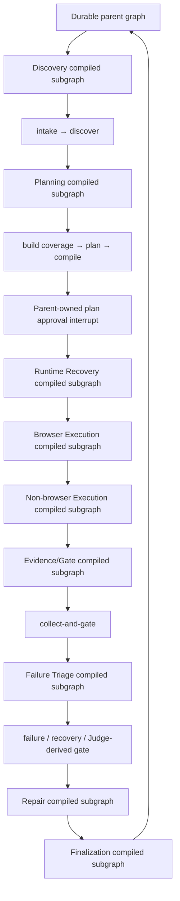

# Typed Subgraph Boundaries

`packages/agent-orchestration/` now separates the LangGraph runtime into seven
layers:

- `state.ts` defines the checkpoint-safe graph state and JSON-safe boundary
  values. Domain sections such as discovery, plan, execution, gate, failure,
  judge and observation are named types rather than anonymous maps.
- `graphNodes.ts` contains node execution, routing helpers, projection and
  interrupt handling.
- `subgraphs.ts` declares the typed business boundaries, compiles the
  Discovery, Planning, Runtime Recovery, Browser Execution, Non-browser
  Execution, Evidence/Gate, Failure Triage, Repair and Finalization
  subgraphs, and checks that every graph node belongs to exactly
  one boundary.
- `discoverySubgraphNode.ts` invokes the complete compiled `intake → discover`
  child with only discovery projection fields; the child cannot inspect plan,
  execution, repair or gate state.
- `planningSubgraphNode.ts` invokes the compiled
  `build-coverage-map → plan → compile` child with only planning fields. The
  durable plan-approval interrupt intentionally remains parent-owned.
- `diagnose-runtime` is a native `createRuntimeRecoverySubgraph()` containing
  `diagnose-runtime → choose-recovery → recover → verify-recovery` and its
  bounded `retry-path`. A credential interrupt therefore resumes inside the
  child, without replaying the recovery action.
- `prepare-sandbox` is a native `createBrowserExecutionSubgraph()` containing
  sandbox preparation, capability approval, observation, action authorisation,
  execution, verification and the bounded browser loop. Its two `interrupt()`
  points retain the nested checkpoint frame.
- `execute` is a native `createNonBrowserExecutionSubgraph()` containing the
  Worker-result interrupt and the one bounded `continue-paths → execute`
  repair continuation. It inherits the same durable parent checkpoint.
- `evidenceGateNode.ts` invokes the compiled Evidence/Gate graph from the
  parent with a filtered input schema and retains only parent lifecycle fields
  for projection/checkpoint continuity.
- `failureTriageSubgraphNode.ts` invokes deterministic triage and optional
  Judge advice with only current evidence facts. The parent routes its result
  to the native Recovery or Repair child without owning either child's work.
- `repair` is a native nested `createRepairValidationSubgraph()` rather than a
  function proxy. Its narrow child state inherits the parent checkpoint, so a
  human repair decision resumes the child without re-running the repair node.
- `finalizationNode.ts` does the same for the terminal publication step, while
  preserving the parent-owned pending-interrupt guard.

The current boundaries are:

| Boundary | Nodes | Responsibility |
| --- | --- | --- |
| discovery | `intake`, `discover` | establish runtime readiness and the observed project inventory |
| planning | `build-coverage-map`, `plan`, `compile`, `approve-plan` | materialize CoverageItems, produce and compile an executable plan; parent owns approval resume |
| runtime-recovery | `diagnose-runtime`, `choose-recovery`, `recover`, `verify-recovery`, `retry-path` | diagnose and retry bounded runtime failures |
| browser-execution | `prepare-sandbox`, `approve-capabilities`, browser action nodes, `decide-next-step` | execute an authorized browser path |
| non-browser-execution | `execute`, `continue-paths` | hand off API/data/background paths to the worker and perform a bounded continuation |
| evidence-gate | `collect-and-gate` | aggregate evidence and compute the machine gate |
| failure-triage | `triage-failure`, `selective-judge` | classify failures and request selective judgment |
| repair-validation | `repair` | apply an approved repair flow; it may route to the separately bounded continuation stage |
| finalization | `finalize` | publish the terminal projection |

`assertTypedSubgraphCoverage()` runs when the graph is constructed. It rejects
duplicate, missing or unexpected node assignments, so adding a node requires an
explicit state-boundary decision.

## Compiled migration status

The parent graph remains the durable LangGraph owner: its `thread_id`,
checkpoint and interruption/resume contract are unchanged. Its `intake` node
invokes the complete `createDiscoverySubgraph()` (`intake → discover`),
`build-coverage-map` invokes `createPlanningSubgraph()`
(`build-coverage-map → plan → compile`), `diagnose-runtime` invokes
`createRuntimeRecoverySubgraph()`, `prepare-sandbox` invokes
`createBrowserExecutionSubgraph()`, `execute` invokes
`createNonBrowserExecutionSubgraph()`, `collect-and-gate` invokes
`createEvidenceGateSubgraph()`, `triage-failure` invokes
`createFailureTriageSubgraph()` (`triage-failure → selective-judge` when a
Judge is needed), `repair` invokes the native
`createRepairValidationSubgraph()`, and `finalize` invokes
`createFinalizationSubgraph()`. All nine are separately compiled children.

Discovery receives only `runId`, `mode`, project/request context, permission,
approval flags and the prior Discovery projection. It may return only Coverage,
Observation and Discovery lifecycle fields. A recovery that needs a fresh
runtime probe re-enters this same child through the parent `intake` proxy;
parent checkpoint ownership is unchanged.

Planning receives only run/project/request context, permission, lifecycle
projection, existing Coverage/Plan/Compiled Plan values and the two current
path identifiers. It may return only those planning values and related
lifecycle projection. It cannot inspect execution, gate, failure, judge,
recovery or repair state. `approve-plan` remains a parent node because the
child deliberately has no independent checkpointer: moving `interrupt()` into
it would re-run planning before an approval resume. The parent checkpoint is
therefore the stable resume contract, while the pre-approval work stays
independently compiled and idempotent.

Runtime Recovery receives only lifecycle projection, project/request context,
permission, Coverage/Observation, the current failure and recovery decision,
result, attempts and attempt identifier. It may return only those recovery
facts plus a fresh Coverage/Observation update. A failed path enters at
`choose-recovery` so the existing triage decision is preserved; a runtime
readiness failure enters at `diagnose-runtime`. `recover` is nested natively
because it may ask for credentials with `interrupt()`: the resume continues at
that exact child checkpoint and never replays a completed recovery action. The
parent only routes the completed child to re-discovery, a queued execution,
Repair, or Finalization.

Browser Execution receives only plan/coverage and browser-loop state, project
context, permission profile and lifecycle fields. It may update only browser
session, observations, decisions, authorised actions, execution hand-off and
loop counters; it cannot read a Gate, failure, Judge, recovery or repair
state. Capability approval and action authorisation execute in this native
child, so their human interrupts resume at the exact nested checkpoint. On an
exit the parent only chooses Worker execution, Evidence/Gate collection or
Finalization. The direct child test covers the no-action completion path; the
Agent regression suite covers the signed action/verification loop and the
Worker-to-browser re-entry route.

Non-browser Execution receives only the compiled plan, Coverage, execution and
attempt/Worker batch state, lifecycle fields, and the bounded continuation
counters. It may return only execution/observation, Worker batch and
continuation updates; it cannot read Gate, failure, Judge, recovery or repair
session data. On a standard entry it waits for the durable Worker result; on a
Repair entry it first evaluates `continue-paths` and executes at most once.
Both flows use the native child checkpoint so an execution-result resume cannot
duplicate a Worker result or repair continuation. The direct child test covers
the continuation-to-execution path, and the Agent suite covers the human
Worker-result interrupt and batch return to Browser.

Evidence/Gate business input is only:

```text
runId, mode, projectId, requirement, execution, currentAttemptId,
browserAgentRequired, browserSession
```

It may return only `gate` and `execution`. Planning, compiled plan, repair,
judge and arbitrary parent state are not passed to the collector. The unit test
compiles and invokes this child directly, and verifies that unrelated parent
fields cannot enter its input.

Failure Triage receives current gate/execution/observation facts, the current
attempt, project/request context, permission profile and prior triage fields.
It may return only `failure`, `recoveryDecision`, `judge`, a Judge-derived
`gate` update and lifecycle projection. A recovery decision remains higher
priority than a Judge call; the child exits after deterministic triage when a
retry is already selected. It never receives a compiled plan, browser-control
state, repair session or recovery result details.

Repair receives only run/project context, permission profile, lifecycle
projection, the current failure/observation and its repair-session identifier.
It may return matching lifecycle, failure/observation and repair-session
updates, but cannot read the compiled plan, machine gate, browser session or
execution state. Unlike proxy children, it is added directly to the parent
`StateGraph`, which preserves the native nested checkpoint/interrupt frame.
The Agent regression suite verifies a repair decision can pause, resume and
survive a restart without running the repair side effect twice.
`continue-paths` remains in the separately bounded non-browser stage, so this
is not yet a complete Repair-and-Validation subgraph.

Finalization receives only `runId`, `mode`, `execution`, `gate`,
`coverageMap`, `discoveryTerminal` and `browserAgentRequired`; it may return
only terminal `status` and `execution`. A parent node with an unresolved
interrupt still stops before invoking the child graph.



All nine declared business boundaries now have a separately compiled narrow
state graph and a direct unit test. The parent retains only cross-boundary
orchestration and the plan-approval checkpoint. This closes the code-level
P0-3 migration requirement; it does not imply acceptance of unrelated P0
requirements such as external-project blind testing.

## Verification

```bash
npm --workspace @ai-test-officer/agent-orchestration run build
npm --workspace @ai-test-officer/agent-orchestration run test
npm run shadow:run
```

`shadow:run` executes 100 deterministic browser/non-browser topology cases and
writes `reports/shadow-graph/latest.json`. The report is synthetic: it proves
repeatable routing and coverage of the typed boundaries, not correctness on
external projects or an improvement in LLM generalization.
